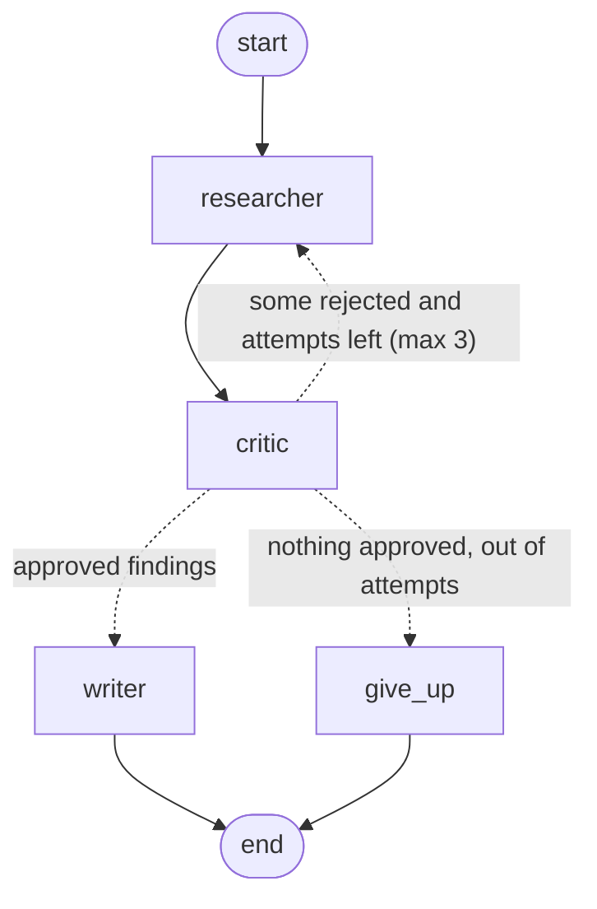

# Research Crew

A small team of AI agents that answers research questions with **every claim backed by a quoted source**,
and a test suite that proves it.

```
Your question
     │
     ▼
Researcher ──► searches the web, writes notes: fact + link + exact quote      ◄── M1
     │
     ▼
Critic ──────► checks each fact against its quote. Weak? ──► back to Researcher   ◄── M2
     │ (approved)
     ▼
Writer ──────► short report, every sentence cited                                  ◄── M2
```

Around it: golden set, code checks, LLM judge (M3), Langfuse traces, and a CI quality gate (M4).

The real graph, as LangGraph draws it (dotted arrows are decisions the code makes after the critic runs):



---

## 1. Explained like you're 5 🧸

| Thing | The kid version | The grown-up version |
|---|---|---|
| **Researcher** | A kid sent to the library with a notebook. For every fact, they must write the book's name and copy the sentence. | A LangChain agent with one tool, `web_search`, that must return `ResearchNotes`. |
| **Tool** (`web_search`) | The library. The kid can only know what's in the books they opened. | A function the LLM may call. Here it calls Tavily, a search API built for agents. |
| **Structured output** | A form with boxes: *fact*, *book*, *copied sentence*. No box can be empty. | `response_format=ResearchNotes` (Pydantic). Malformed answers fail immediately. |
| **Gaps** | "I couldn't find this in any book" instead of making it up. | The `gaps` list. Honest "don't know" beats a confident guess. |
| **Fake mode** | Practising with three pretend books at home before going to the real library. | `research_fake` + `tests/fixtures`: no API key, no cost, same result every run. |
| **Langfuse** | A camera recording every book the kid opened and how long it took. | Traces of every LLM call and tool call, with cost and latency. |
| **Critic** (M2) | Mom checking the homework. First with a ruler: "is this sentence really in that book?" Then by reading: "does that sentence really say what you wrote?" | `critic.py`: a free code check (quote is word for word in a page the search returned), then one Claude call that judges whether the quote *supports* the claim. |
| **Retry loop** (M2) | Mom hands the homework back: "these two are wrong, go fix them". At most 3 tries. | A LangGraph edge that points back to the researcher, carrying the critic's feedback. |
| **Writer** (M2) | The kid's big sister writes the final paragraph, using only the facts Mom ticked. She never goes to the library herself. | `writer.py`: Claude writes from approved findings only, with `[n]` citations. |
| **Give up** (M2) | "I couldn't find enough good books, so I won't make up an answer." | The `give_up` node: status `insufficient_evidence`, no citations. |
| **Golden set** (M3) | The answer key the teacher writes *before* the test. For research it can't be exact words (the web changes), so it lists what a good answer must have: "says *documents*", "cites 2 books", "never says *impossible*". | `evals/golden_set.jsonl`: 13 cases in 6 categories, built by `evals/build_golden_set.py`. |
| **Code checks** (M3) | A ruler. Same answer every time, free. | `evals/evaluators.py`: status, citation faithfulness, citations valid, must mention, must not say. |
| **Citation faithfulness** (M3) | "Of all the sentences you copied, how many are really in the book?" Should be 100%. | The headline metric. Re-checked by the eval, independently of the critic, so a weakened critic can't hide. |
| **LLM judge** (M3) | A teacher robot with a checklist who reads the report: "did you add anything the books don't say? did you fall for a trick question?" | DeepEval `GEval` with Claude Sonnet, judging against the approved quotes only. |
| **Scorecard** (M3) | The report card: one row per question, PASS/FAIL, and why. | `python -m evals.run_evals`; exit code 1 on any failure, ready for CI in M4. |
| **LangGraph** (M2) | The chore chart on the fridge: who goes after whom, and when to go back a step. | `graph.py`: nodes share one `state` dict; edges (some conditional) pick the next node. |

---

## 2. What's in the repo

| File | What it is |
|---|---|
| `research_crew/models.py` | The forms the agents pass around: `Source`, `Finding`, `ResearchNotes` |
| `research_crew/search.py` | Real search (Tavily) and fake search (fixtures) with the same shape |
| `research_crew/researcher.py` | The Researcher: system prompt, `web_search` tool, `research()` and `research_fake()` |
| `research_crew/tracing.py` | Turns on Langfuse only if keys are set |
| `research_crew/critic.py` | The Critic: code check + LLM support check, returns a `Critique` with per-finding verdicts |
| `research_crew/writer.py` | The Writer, plus the honest "not enough evidence" report |
| `research_crew/graph.py` | The LangGraph graph that wires all three together, with the retry loop |
| `main.py` | Ask a question from your terminal (`--fake` offline, `--researcher-only` for M1) |
| `tests/test_researcher.py` | Researcher tests: 6 offline + 1 live |
| `evals/build_golden_set.py` | The golden set, with comments on *how* to choose test questions |
| `evals/evaluators.py` | 5 code checks + the LLM judge |
| `evals/run_evals.py` | The end-to-end eval run: scorecard, Langfuse experiment, exit code |
| `tests/test_evaluators.py` | Tests for the graders themselves (8 offline) |
| `tests/test_golden_set.py` | The golden set against the real crew, one test per case (needs keys) |
| `tests/test_crew.py` | Critic + graph tests with deliberately bad researchers: 10 offline + 1 live |
| `.github/workflows/tests.yml` | Runs the offline tests on every push |

---

## 3. How to use it (on your Mac)

### Step A: run it offline, free, in 2 minutes

Needs **Python 3.10+**. macOS's built-in `python3` is 3.8, so this uses [uv](https://docs.astral.sh/uv/),
which downloads its own Python without touching the system one.

```bash
curl -LsSf https://astral.sh/uv/install.sh | sh && source $HOME/.local/bin/env   # once per machine
git clone https://github.com/Vindaru/-research-crew.git research-crew
cd research-crew
uv venv --python 3.12 && source .venv/bin/activate
uv pip install -r requirements.txt

python main.py --fake "What is retrieval-augmented generation?"
python -m pytest -q          # expect: 24 passed, 15 skipped
```

You'll see how many times the researcher ran, how many findings the critic approved or rejected (and why),
then the writer's report with `[1]`, `[2]` citations and the URL list. Try a question the fixtures can't answer
(`python main.py --fake "Who won the 1987 chess olympiad?"`) and the crew says **insufficient_evidence**
instead of guessing. Add `--researcher-only` to see just the M1 notes.

To *see* the retry loop without an API key, read `tests/test_crew.py`: `liar_then_honest` is a researcher that
invents a quote on its first try. The test shows the critic rejecting it, the researcher getting the feedback,
and the bad claim never reaching the report.

### Step B: the real thing (Claude + live web)

1. Get a free Tavily key at https://app.tavily.com.
2. `cp .env.example .env` and fill in `ANTHROPIC_API_KEY` and `TAVILY_API_KEY`.
3. Run:

```bash
set -a && source .env && set +a
python main.py "What changed in the EU AI Act in 2026?"
python -m pytest -q          # now the live tests run too (the 13 golden cases take a few minutes)
```

### Step C: watch it think (Langfuse)

Start your local Langfuse (the same one ClaimStream uses), put its keys in `.env`, and run Step B again.
Open Langfuse → **Traces** → the newest `research-crew` trace. Inside it you'll see one span per graph node:
`researcher` (its searches and the structured notes), `critic` (the verdicts), maybe `researcher` again,
then `writer` or `give_up`, with tokens, cost and seconds for each.

**What to look for:** how many attempts it took, *which* findings the critic rejected and why,
whether the writer cited only approved sources, and which node was slowest or most expensive.
That's how you debug a multi-agent system: find the agent that went wrong, not just the final answer.

### Step D: grade it (the eval run)

```bash
python -m evals.run_evals --fake     # offline report card, free
python -m evals.run_evals            # real crew + LLM judge (keys from .env); costs a few cents
```

You get one row per golden case with a score per grader, PASS/FAIL, the reason for each failure,
and the overall **citation faithfulness**. The offline run shows **12/13**: the fake researcher is lazy
(it only copies the first sentence of each page), so `false-premise-02` misses the word "reduces".
That's on purpose. It shows what a real failure looks like and proves the graders can fail.

With Langfuse keys set, the golden set is uploaded as dataset `research-crew-golden-v1` and each run becomes an
**experiment**. Open Langfuse → Datasets → research-crew-golden-v1 → Runs to compare runs side by side:
change a prompt or a model (`RESEARCHER_MODEL=claude-sonnet-5-5 python -m evals.run_evals`) and see whether
scores, cost and latency went up or down. That's choosing a model with evidence instead of vibes.

### Where this pattern is used in real life

- **Analyst and market research:** "summarise what competitors launched this quarter, with sources".
- **Due diligence / compliance:** every statement must be traceable to a document an auditor can open.
- **Literature reviews:** healthcare, legal and academic teams collecting cited evidence fast.
- **Internal knowledge:** swap `web_search` for a search over your company's docs and it becomes a cited RAG researcher.

---

## 4. Milestones

- [x] **M1** Researcher agent with web search, structured cited output, Langfuse tracing, offline tests
- [x] **M2** LangGraph graph: researcher → critic → writer, with a retry loop and a "not enough evidence" exit
- [x] **M3** Golden set (13 cases, 6 categories), code checks (citation faithfulness) + LLM judge + Langfuse experiments
- [ ] **M4** CI eval gate, demo GIF, write-up
